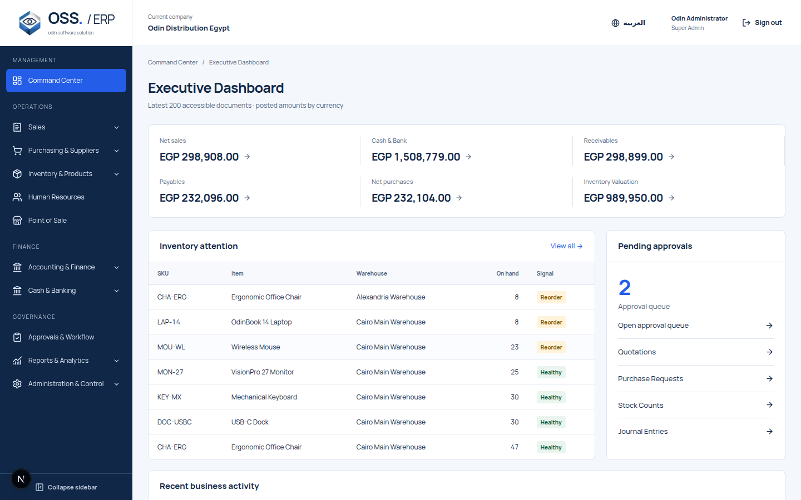
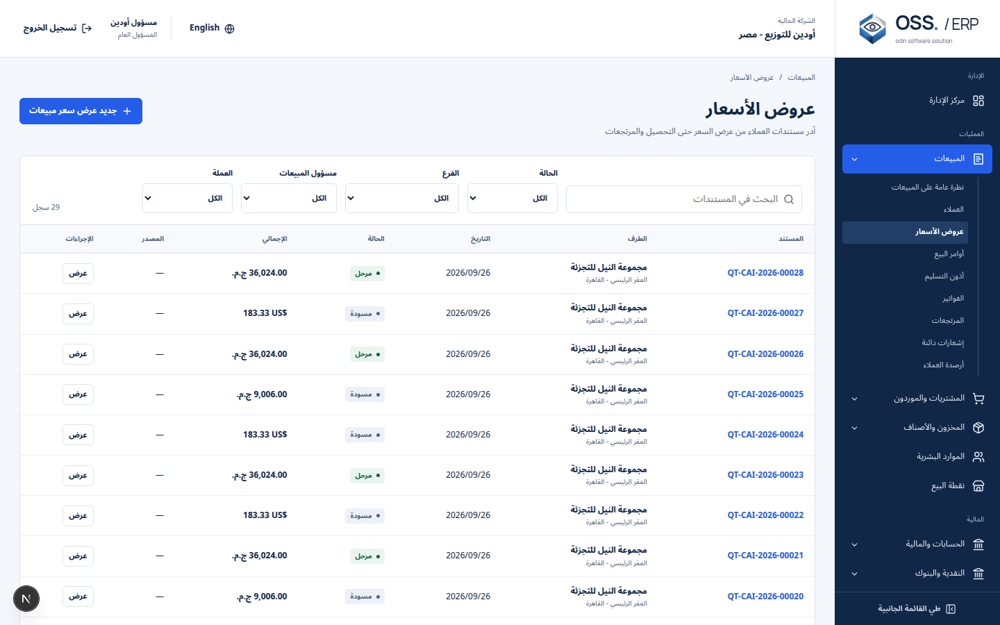
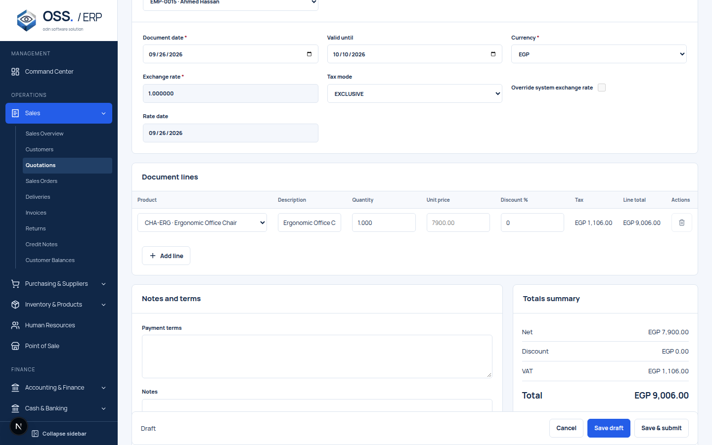
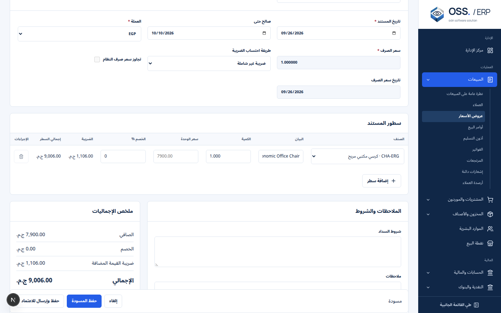

# ODIN ERP replacement identity

Corporate source: `mohammaddashraff/odin-corporate-site`, inspected 26 September 2026. The ERP adaptation uses the original geometric eye and `OSS. / ERP` live-text lockup. No corporate repository files were modified.

| Corporate token | Exact value |
| --- | --- |
| Blue | `#245DE8` |
| Button hover | `#1545BD` |
| Navy / text | `#102747` |
| White | `#FFFFFF` |
| Panel | `#F4F7FC` |
| Muted | `#53647B` |
| Border | `#DCE4EF` |
| English | Manrope, local regular and bold |
| Arabic | Noto Sans Arabic, local regular and bold |

Sources inspected: `app/globals.css`, `app/home-experience.css`, `app/layout.tsx`, `lib/site.ts`, `lib/brand.ts`, and `components/ui/logo.tsx`. The live site's text was accessible and agreed on OSS identity, but deployed-revision equivalence is not assumed.

## ERP adaptations

A navy navigation rail, light logo area, white context bar, pale workspace, compact table and full-page editor system are new application compositions. They are not copies of the marketing site or the rejected ERP UI. Brand artwork is packaged locally, kept in its original aspect ratio, and clipped only as specified in corporate CSS. The lockup always remains LTR.

Application semantic colors, density, 8px radii, focus treatment, and responsive behavior are additions. Design concepts are retained under `docs/ui-v2/concepts`. Generated sample values are design-only; implementation must use API data. Unsupported generated search, notifications, expense claims, and sample identities are excluded by the specification.

Verification and implementation status are tracked in `ui-v2-parity.md`.

## Source trace and local assets

Reference repository: [mohammaddashraff/odin-corporate-site](https://github.com/mohammaddashraff/odin-corporate-site). Corporate source blobs recorded during inspection:

| File | Git blob |
| --- | --- |
| `app/globals.css` | `77cdf2767b7e2e37716015a77dacfde44cce4259` |
| `lib/brand.ts` | `03b49c41214de82ec6426e5a318eb9001dbea7a1` |
| `components/ui/logo.tsx` | `618601976f045daa03e4ea0f69631f8d52779563` |
| `app/layout.tsx` | `23de9a8be9fe4f16cd96093730a683b30f94e581` |
| `lib/site.ts` | `9b38d0b6d70979c43cb53f267c6fb7c4cf8544c7` |

The four local TTF files and geometric-eye PNG come from that repository. Font licenses are packaged alongside the fonts: `manrope-OFL.txt` and `noto-arabic-OFL.txt` (SIL Open Font License 1.1). No hotlinked font or logo dependency is used. The secondary surface is the verified `#E9EEF8`.

## Contrast and visual fidelity review

Computed WCAG relative-luminance ratios are retained in [contrast.json](ui-v2/contrast.json), using the actual CSS values. Blue on white is 5.52:1, navy on the pale workspace 13.94:1, and muted text on the workspace 5.63:1. Success `#14613F` / `#EAF5EF`, danger `#AA2439` / `#FCECF0`, and warning `#835600` / `#FFF3DB` are ERP additions; each exceeds 4.5:1. Status text and dots accompany color. Focus uses a visible blue outline. Light borders are separators, not the sole indicator of control state.

| Concept / real evidence | Review and implementation decision |
| --- | --- |
| Dashboard concept / `screenshots/dashboard-en-1920.png` | Navy grouped rail, white logo/context area and pale workspace retained. Actual scoped inventory, approvals and audit rows replace generated sample activity. No invented trends or expense module. |
| Dashboard at 1366 and 1440 | Six financial summaries use three columns at ordinary desktop sizes and six at wide desktop; fixed an earlier amount-wrapping defect. Currency values remain separate, tabular and LTR. Document-derived totals explicitly describe the API's latest-200-document window. |
| Listing concept / `screenshots/listing-en-1440.png` | Compact header, persistent toolbar, neutral financial table and restrained blue links retained. Actual server filters and pagination replace concept sample controls. |
| Editor concept / `screenshots/editor-en-1440.png` and `editor-lines-en-1440.png` | Full-page grouped context, editable lines, terms and exact totals retained. Additional fields are required by the existing commercial and exchange-rate contracts. Sticky save actions stay reachable; the separate line screenshot records the scrolled editor. |
| Detail / `screenshots/detail-en-1440.png` | Summary, operational tabs, locked posted state, source links and financial totals are real document data. Posted/edit and conversion availability come from existing API rules. |
| Arabic concept / `screenshots/listing-ar-1440.png` | Right-side navigation and Noto Sans Arabic are retained; official lockup stays LTR. Arabic reference names use the existing dictionary; Latin document IDs and numbers stay isolated. |
| Narrow Arabic / `screenshots/listing-ar-390.png` | Table scroll stays inside its region. Earlier squeezed IDs and dates were fixed with minimum table widths and no-wrap identifiers. Desktop columns remain accessible by horizontal scroll. |
| Dialog / `screenshots/dialog-en-1440.png` | Native modal semantics, keyboard focus trapping, Escape and focus return verified. Protected re-authentication now uses a masked dialog while retaining the same step-up API. |
| Loading/error/empty and print captures | Actual controlled pending/error/retry states, no-match search and CSS print layout are captured, independently of the healthy populated screens. |

Operational screenshots contain only isolated QA data. `deployed-login-en.png` records the public login screen without credentials or business records. `restricted-price-en.png` captures a controlled omitted-price response and verifies that unavailable pricing is labeled Restricted rather than zero. Visual review was against the generated concepts and verified corporate source; it does not claim a pixel match to the live marketing deployment.

## Representative implementation captures

These are browser captures of the API-connected replacement, not the generated concepts.

## Final accessibility review

The actual mobile navigation was inspected in both directions after its opening transition settled. Its 238px panel remains wholly inside the 390px viewport. Hidden navigation is inert; opening contains keyboard focus, Escape closes it, and focus returns to the menu control. Captures: `navigation-en-390.png` and `navigation-ar-390.png`.

The English and Arabic transaction editors also passed at a 720×450 CSS viewport with device scale 2, equivalent to the layout space of a 1440×900 desktop at 200% zoom. Save/cancel controls remained operable and wide financial tables scrolled locally. Captures: `editor-en-zoom-200.png` and `editor-ar-zoom-200.png`. This checks zoom-equivalent reflow, not a claim about every browser's zoom implementation.
